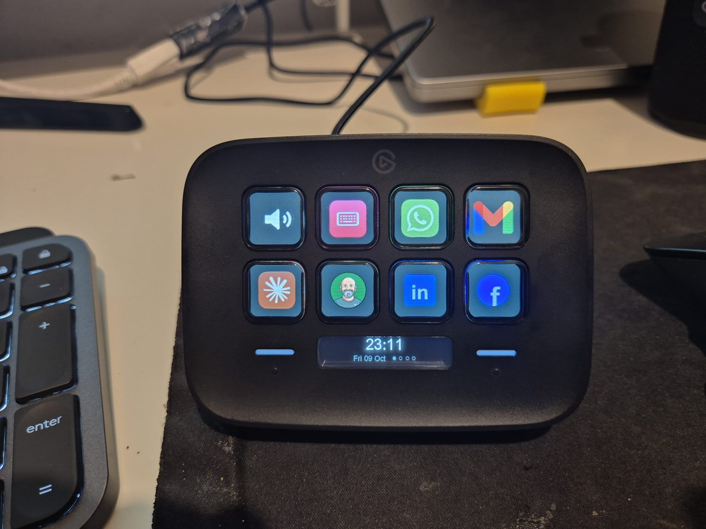
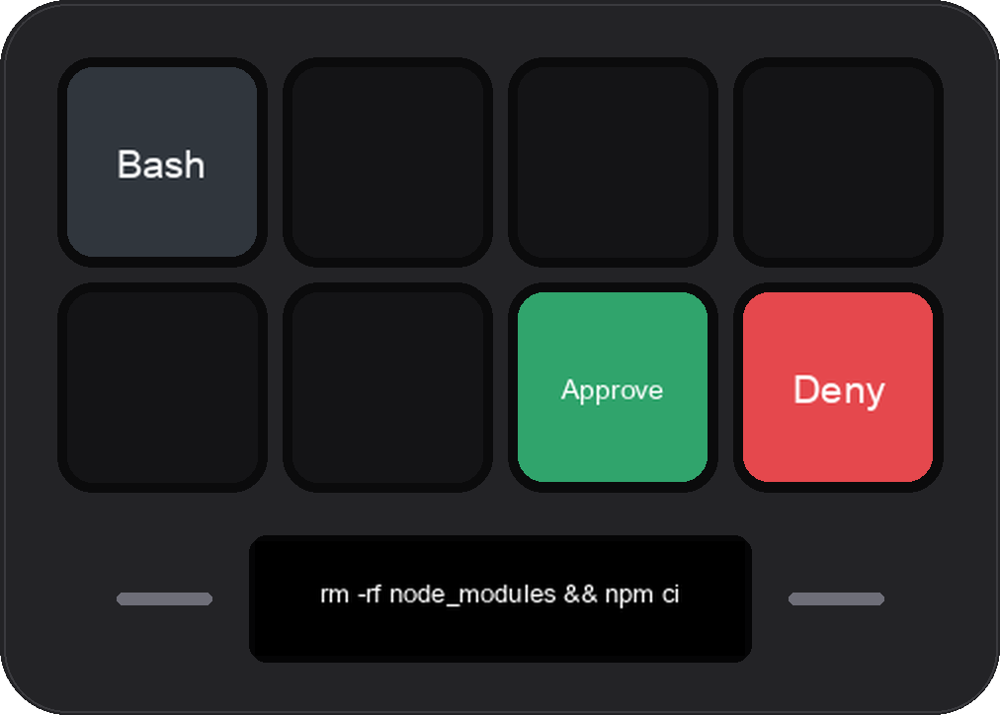
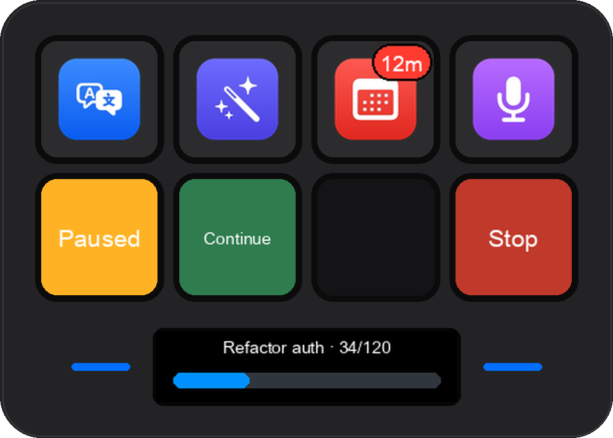
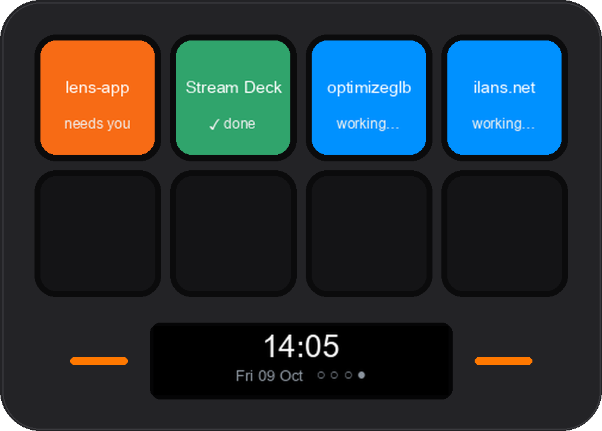

# streamdeck-agents

**A Stream Deck Neo as a physical interface for AI coding agents.** No Elgato software: a small Python daemon drives the
device over USB, and Claude Code talks to it through hooks and an MCP server. Agents ask permission on a key, show a
progress bar, and pause or stop when you press. A page shows every running session. Hold a key and speak, and a small
model picks which key to press.

Write-up: **[Eight keys between me and the agents](https://ilans.net/writing/eight-keys-between-me-and-the-agents.html)**

<p align="center"></p>

| Permission prompt | Pause / Continue / Stop | Sessions page |
|---|---|---|
|  |  |  |

> Built in a day for my own desk (macOS on Apple Silicon, a Stream Deck **Neo**). It works and I use it daily, but
> treat it as a well-documented starting point rather than a product.

## What it does

- **Approve from the desk.** A Claude Code `PermissionRequest` hook shows the command on the display with Approve /
  Deny keys. No press in 25 s, daemon down, or device busy → Claude Code shows its normal prompt. Worst case = the old behaviour.
- **Steer long tasks.** MCP tools let an agent put Pause / Continue / Stop on the keys and check between steps
  (`deck_check` blocks while paused), show a real progress bar, or ask a multiple-choice question answered by a key press.
- **Sessions page.** Hooks track every Claude Code session (working / done / waiting for you); a page builds itself
  while sessions exist, named like the Claude app's sidebar, and a press jumps to that session.
- **Voice.** Hold Talk, speak (Hebrew or English): local whisper.cpp transcribes, Claude Haiku picks **one** action from
  a closed list (your keys + timer / note / page). Keys marked `confirm` ask for a Yes on the deck first.
- **Text keys.** Select text anywhere and press: wrong-keyboard-layout fix (no AI), translate, improve. Replaced in place.
- **Dashboard** at `http://127.0.0.1:8885`: drag keys between slots and pages, drop an image on a key to change its icon,
  edit commands, park keys in a drawer. Saves straight to the device, with backups.
- **Glanceable bar.** Clock and page dots, timers, meeting alerts (from macOS Calendar, so Outlook/Exchange/Google all work),
  and one-line notices from agents.

## How it fits together

```
 Stream Deck ── USB ── deck.py ── http://127.0.0.1:8885 ──┬── notify.py      (mute, calendar, Claude sessions…)
 (8 keys + bar)        draws keys & bar,                  ├── hook_*.py      (Claude Code hooks)
                       runs a key's command               ├── mcp_server.py  (tools agents call)
                                                          ├── actions/*      (what keys run; voice router)
                                                          └── dashboard/     (layout editor)
```

Everything is driven by `profile.json` (pages, keys, which live features paint which key). Start from
`profile.example.json`.

## Install

Requirements: Apple Silicon Mac, a Stream Deck Neo (other models should mostly work - untested), Homebrew, Xcode
Command Line Tools. Quit the Elgato Stream Deck app if it's installed - only one program can hold the device.

```bash
brew install hidapi fribidi
git clone https://github.com/ilan-stack/streamdeck-agents.git ~/streamdeck-agents
cd ~/streamdeck-agents && ./install.sh
```

The installer creates `.venv`, copies the two libraries into `lib/`, builds the native helpers into `bin/`, renders the
default icons, registers the Claude Code hooks and the MCP server (`claude mcp add --scope user streamdeck …`), and
starts two LaunchAgents. Re-run it any time; `./uninstall.sh` removes the services and hooks.

Then grant two macOS permissions (they're the hard part, see [why](#macos-permissions)):
1. **Accessibility** → add the `Python.app` path the installer prints (it's on your clipboard) - for keys that send
   keystrokes (layout fix, translate, screenshot, record).
2. **Calendars** and **Microphone** prompts appear the first time, in the name of "StreamDeck Calendar" / "StreamDeck Mic".

Optional:
- **API key** for translate / improve / voice: `~/.config/streamdeck/anthropic_key` (or `ANTHROPIC_API_KEY`). Uses
  Claude Haiku, a fraction of a cent per press.
- **Push-to-talk**: `brew install whisper-cpp` and a model at `~/models/ggml-large-v3-turbo.bin` (or set `WHISPER_MODEL`).
  The server starts on the first press and stops after 10 idle minutes (it holds ~1.8 GB).

## MCP tools

| Tool | |
|---|---|
| `deck_layout` | see every page and key |
| `deck_show` | one line on the display |
| `deck_progress` | progress bar for a long task |
| `deck_ask` | question with 2-7 answers on keys; returns the press |
| `deck_controls_start` / `deck_check` / `deck_controls_end` | Pause / Continue / Stop around a long task |
| `deck_buttons_start` / `deck_wait_press` | temporary task buttons (e.g. Approve / Changes / Next) |
| `deck_light` | badge on an existing key |
| `deck_add_key` / `deck_move_key` / `deck_remove_key` | edit the layout from a conversation |

Suggested rule for your `CLAUDE.md`: use the deck sparingly - `deck_ask` for real decisions, `deck_progress` only for
tasks over a minute, `deck_show` for one final result.

## Security notes

- The HTTP API listens on `127.0.0.1` only. Writes that change commands (`/api/profile`, icons) require the dashboard's
  `Origin` **and** a per-start token, so another website open in your browser can't rewrite your keys.
- **Keys added from a chat may only open an app, open a link, or run an existing `actions/` script.** Anything else must
  be entered in the dashboard. An agent that read a malicious page must not be able to plant `curl … | sh` on a key you'll
  press later. (Quoted links are checked for `$` and backticks too - double quotes still expand them.)
- Voice can only trigger existing keys and four built-ins, never a free-form command.

## macOS permissions

The daemon is a background process started by launchd, and macOS privacy prompts are designed for apps a person
launches. What that meant in practice:
- A background Python is never shown the Microphone or Calendars prompt, and the Microphone list has no "+" button.
  So recording and calendar access live in tiny `.app` bundles with their own usage descriptions, started with `open`.
- Permissions are checked against the binary that was launched - the venv's `python` symlink doesn't count, so the
  services run the real `Python.app` with `PYTHONPATH` pointing at the venv.
- AppleScript keystrokes are refused as "osascript"; `actions/keys.py` posts CoreGraphics events from Python instead.

Other traps worth knowing: `streamdeck` 0.9.7/0.9.8 crash on Python 3.9 (pinned to 0.9.6); Pillow finds `fribidi` only by
bare name at import, so it's imported from inside `lib/` (otherwise Hebrew renders reversed); `ThreadingHTTPServer`'s default
backlog of 5 drops connections when the dashboard loads icons in parallel.

## License

MIT. Stream Deck is a trademark of Corsair/Elgato; this project is not affiliated with them. App logos are not included -
the installer renders generic SF Symbol tiles on your Mac, and you can drop your own images on keys in the dashboard.
